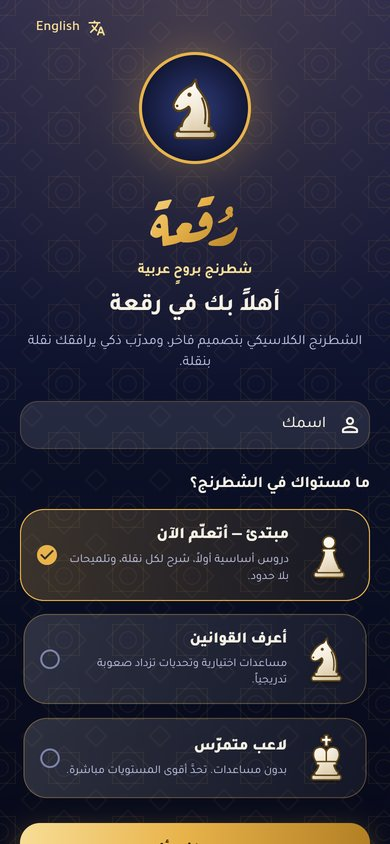
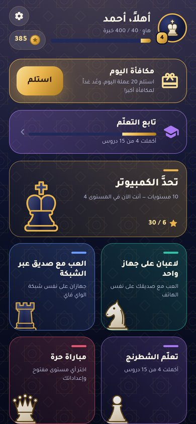
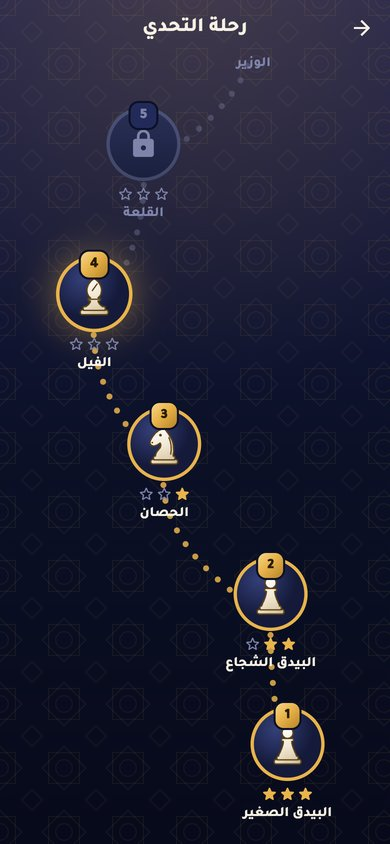
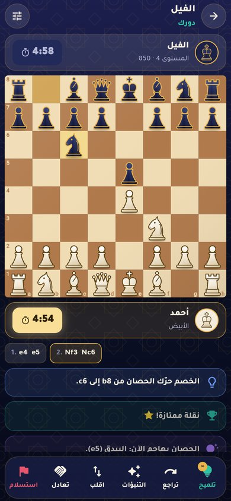
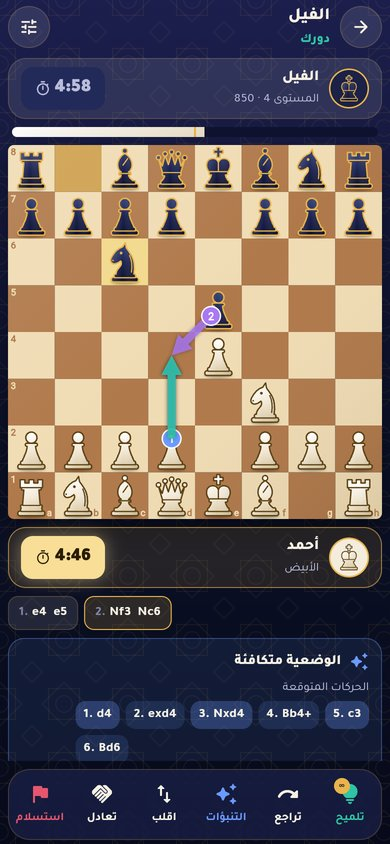
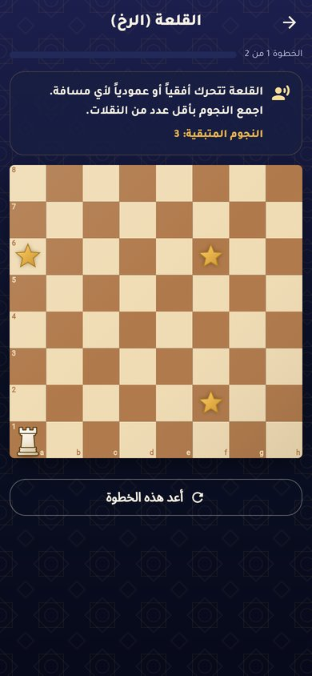
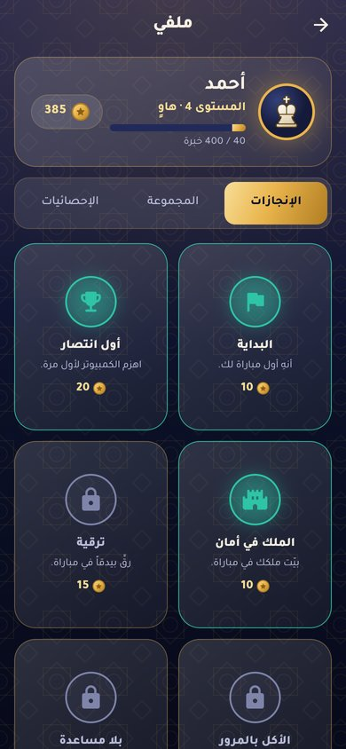
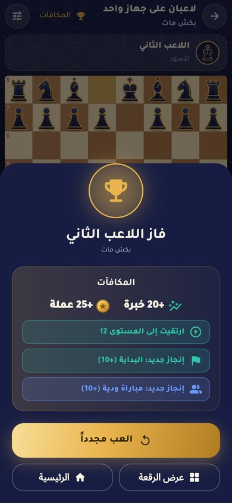

<div dir="rtl">

# رُقعة — شطرنج بروحٍ عربية ♞

لعبة شطرنج كلاسيكية كاملة مبنية بـ **Flutter**، بتصميم فاخر بطابع «ليالي الملوك» (أزرق ليلي، لمسات ذهبية، وزخارف هندسية إسلامية)، مع مدرّب ذكي يشرح كل نقلة للمبتدئين.

| | | | |
|:-:|:-:|:-:|:-:|
|  |  |  |  |
|  |  |  |  |

## تحميل التطبيق (أندرويد)

**[⬇️ حمّل أحدث نسخة APK](https://github.com/ahmedalgarbani/Chess-game/releases/latest/download/ruqa-chess.apk)** — أو تصفّح كل النسخ في صفحة [Releases](https://github.com/ahmedalgarbani/Chess-game/releases).

تُبنى النسخة تلقائياً عبر GitHub Actions (`.github/workflows/android-apk.yml`) مع كل تحديث للكود. عند التثبيت اسمح بـ«تثبيت التطبيقات من مصادر غير معروفة».

## المزايا

### أوضاع اللعب
- **ضد الكمبيوتر بعشرة مستويات** تبدأ من «البيدق الصغير» (يخطئ كثيراً مثل المبتدئ) وتنتهي بـ«الأسطورة» (المحرك بكامل قوته). المستويات تُفتح تدريجياً في «رحلة التحدي».
- **لاعبان على جهاز واحد** مع قلب الرقعة تلقائياً بعد كل نقلة (اختياري).
- **مع صديق على نفس الشبكة (Wi-Fi)**: أحدكما ينشئ مباراة والآخر يجدها تلقائياً أو يُدخل العنوان يدوياً. يدعم عرض التعادل، الاستسلام، مباراة الإعادة، وتفاعلات الإيموجي.
- **مؤقت اختياري للطرفين**: بدون مؤقت، أو 1، 3+2، 5، 10، 15+10، 30 دقيقة.

### المستويات والمكافآت
- نقاط خبرة (XP) ومستوى وألقاب للاعب (مبتدئ ← أستاذ كبير).
- عملات ذهبية، ونجوم (1–3) لكل فوز بحسب استخدام التلميحات والتراجع.
- 20 إنجازاً، ومكافأة يومية تكبر مع الأيام المتتالية.

### المتجر (يُشترى بعملات المكافآت)
- **ثيمات للتطبيق كله** تتبدل فوراً مع انتقال ناعم للألوان: ليالي الملوك، واحة الزمرد، غروب الصحراء، قصر الورد، لؤلؤ البحر، السبج والفضة.
- **12 رقعة و8 أطقم قطع** (منها الخشب، الوردي والأونيكس، الجليد والحمم).
- **الصورة الرمزية**: اختر قطعتك واشترِ لها إطاراً (فضي، زمردي، ياقوتي، سماوي، لهب، قوس قزح).
- **ألقاب** تظهر بجانب اسمك: فارس الرقعة، صياد الملوك، التكتيكي، الاستراتيجي، صقر الصحراء، السلطان، الأسطورة.
- **معززات**: حزمة 5 تلميحات إضافية (تُصرف بعد نفاد تلميحات المباراة المجانية)، مضاعف الخبرة ×2 لثلاث مباريات، ودرع السلسلة الذي يحمي المكافأة اليومية إذا فاتك يوم.

### ألغاز الشطرنج
- 28 لغزاً تكتيكياً: كش مات في نقلة ونقلتين (منها مات فيليدور، مات ليغال، لعبة الأوبرا لمورفي، مات بودن، المات العربي)، الشوكة، السيخ، التثبيت، الكشف، والترقية.
- **لغز اليوم** بمكافأة إضافية 50 عملة، وتلميح يضيء القطعة المطلوبة.
- يُقبل أي كش مات صحيح وليس الحل المسجّل فقط، وكل لغز مُتحقَّق منه آلياً بالمحرك في الاختبارات.

### سجل المباريات والاستئناف
- آخر 30 مباراة محفوظة في الملف الشخصي، مع **شاشة مراجعة** للتنقل بين النقلات وتحليل أي وضعية بالمحرك (أفضل نقلة بسهم).
- المباريات غير المكتملة (ضد الكمبيوتر أو على جهاز واحد) تُحفظ تلقائياً مع وقت الساعة، ويمكن **استئنافها** من الشاشة الرئيسية.

### للمبتدئين: «وضع التعلّم»
- عند اختيار «مبتدئ» في البداية يُنقل اللاعب إلى **أكاديمية رقعة**: 15 درساً تفاعلياً (الرقعة، كل قطعة، الكش، كش مات، التبييت، الأكل بالمرور، الترقية، التعادل، مبادئ الافتتاح…).
- **مدرّب أثناء اللعب** يشرح كل شيء: كيف تتحرك القطعة أول مرة، ماذا فعل الخصم، القطع المهددة، نصائح الافتتاح، وتقييم كل نقلة (ممتازة/جيدة/غير دقيقة/خطأ/خطأ فادح) مع النقلة الأفضل.
- **تلميحات بلا حدود** مع شرح سبب النقلة المقترحة (3 تلميحات للمباراة خارج وضع التعلّم).
- صعوبة تتدرج تلقائياً: بعد الفوز يظهر زر «المستوى التالي».

### التأمينات (مساعدات اختيارية)
كلها قابلة للتشغيل والإيقاف من الإعدادات أو من داخل المباراة:
- إظهار النقلات الممكنة للقطعة المختارة.
- تمييز قطعك المهددة بإطار أحمر.
- **الحماية من الأخطاء الفادحة**: قبل نقلة تخسر قطعة أو تسمح بكش مات تظهر رسالة تحذير مع رد الخصم المتوقع واقتراح أفضل.
- السماح بالتراجع.

### التنبؤات المستقبلية
- شريط تقييم يوضح من المتقدم.
- **الحركات المتوقعة** القادمة (أفضل خط للمحرك) كنص وأسهم مرقّمة على الرقعة.
- سهم أحمر لتهديد الخصم إن لم تنتبه له.

## التشغيل

```bash
flutter pub get
flutter run            # على الهاتف أو المحاكي
flutter test           # 75 اختباراً
```

يتطلب Flutter 3.47 أو أحدث (Dart 3.13).

### ملاحظات اللعب عبر الشبكة
- يستخدم TCP على المنفذ `47474` للمباراة، وبث UDP على المنفذ `47475` لاكتشاف المباريات.
- على أندرويد تُطلب صلاحيات الشبكة تلقائياً (موجودة في `AndroidManifest.xml`).
- على iOS قد يحتاج الاكتشاف التلقائي (بث UDP) إلى صلاحية Multicast من Apple؛ الإدخال اليدوي للعنوان يعمل دائماً.
- للعدالة، تتوقف التلميحات والتنبؤات والحماية من الأخطاء في مباريات الشبكة.
- اللعب عبر الشبكة غير متاح في نسخة الويب (المتصفح لا يسمح بالـ sockets).

### توقيع ثابت للتحديثات (اختياري)
بدون إعداد إضافي تُوقَّع كل نسخة بمفتاح تجريبي مختلف، فيلزم حذف النسخة القديمة قبل تثبيت الجديدة. لتثبيت التحديثات فوق القديمة مباشرة، أنشئ مفتاحاً وأضفه في *Settings ← Secrets and variables ← Actions* بهذه الأسماء:
`ANDROID_KEYSTORE_BASE64`، `ANDROID_KEYSTORE_PASSWORD`، `ANDROID_KEY_ALIAS`، `ANDROID_KEY_PASSWORD`.

```bash
keytool -genkey -v -keystore upload-keystore.jks -keyalg RSA -keysize 2048 -validity 10000 -alias upload
base64 -w 0 upload-keystore.jks   # قيمة ANDROID_KEYSTORE_BASE64
```

## البنية (Clean Architecture)

```
lib/
├── engine/                 # محرك شطرنج بلغة Dart فقط (بدون Flutter)
│   ├── src/                # الرقعة 0x88، توليد النقلات، FEN، SAN، قوانين التعادل
│   └── ai/                 # بحث Alpha-Beta، التقييم، جدول التحويل، التكتيكات
├── core/                   # الثيم، النصوص (عربي/إنجليزي)، الرقعة والقطع المرسومة، عناصر مشتركة
├── app/                    # نقطة التركيب (Dependency Injection) والتنقل
└── features/
    ├── game/               # domain (الإعداد، الساعة، المدرّب) • data (المحرك في Isolate) • presentation (Cubit + الشاشات)
    ├── lessons/            # المنهج والدروس التفاعلية
    ├── levels/             # رحلة التحدي
    ├── progress/           # الخبرة، العملات، الإنجازات، قواعد الشراء والمعززات
    ├── shop/               # شاشة المتجر
    ├── puzzles/            # الألغاز، البحث عن المات القصير، لغز اليوم
    ├── history/            # سجل المباريات، المراجعة، المباراة المحفوظة
    ├── settings/           # الإعدادات والتأمينات
    ├── lan/                # بروتوكول الشبكة، TCP/UDP، صالة الانتظار
    ├── onboarding/
    └── home/
```

- **إدارة الحالة**: `flutter_bloc` (Cubits)، والتخزين: `shared_preferences`.
- **المحرك** مستقل تماماً ويعمل في Isolate منفصل حتى لا تتجمد الواجهة. يتحقق من صحة توليد النقلات باختبارات *perft* القياسية.
- **القطع مرسومة بالكامل بالكود** (CustomPainter) بتصميم خاص، بدون صور.
- الخطوط: [Tajawal](https://fonts.google.com/specimen/Tajawal) و[Aref Ruqaa](https://fonts.google.com/specimen/Aref+Ruqaa) برخصة SIL OFL (ملفات الرخصة في `assets/fonts`).

### مستويات الكمبيوتر

| المستوى | الاسم | القوة التقريبية | الأسلوب |
|:-:|---|:-:|---|
| 1 | البيدق الصغير | 250 | عمق 1، أخطاء عشوائية كثيرة |
| 2 | البيدق الشجاع | 450 | يأكل كل شيء دون الانتباه للرد |
| 3–4 | الحصان، الفيل | 650–850 | عمق 2 مع أخطاء أقل |
| 5–6 | القلعة، الوزير | 1050–1250 | عمق 3 ونادراً ما يخطئ |
| 7–10 | الملك ← الأسطورة | 1450–2100 | بحث كامل بالوقت والعمق |

</div>

---

**Ruqa** is a complete chess game in Flutter with a royal Arabic look: play the computer across 10 levels, play a friend on the same phone or over Wi-Fi, use optional clocks, earn XP, coins, stars and achievements, learn with 15 interactive lessons and an in-game coach, and turn on safeguards (blunder guard, threat highlights, undo) and predictions (evaluation bar, expected line, threat arrows). Arabic (RTL) is the default language; English is available in settings.
